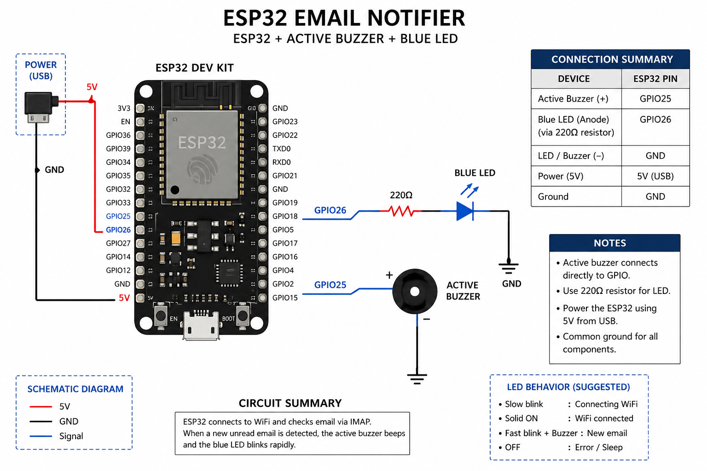

# ESP32 Email Notifier

A compact Wi-Fi enabled email notification device built using ESP32 Dev Board.

The device connects to Gmail using IMAP and plays different melodies for:

* Power ON
* WiFi Connected
* New Email Received

A single blue LED is used for visual status indication.

---



# Features

* WiFi connectivity using ESP32
* Gmail IMAP integration
* Passive buzzer melody notifications
* Single status LED
* Detects new unread emails
* Minimal hardware design
* PlatformIO compatible
* Lightweight and low-cost

---

# Hardware Requirements

| Component            | Quantity    |
| -------------------- | ----------- |
| ESP32 Dev Board      | 1           |
| Passive Piezo Buzzer | 1           |
| Blue LED             | 1           |
| 220Ω Resistor        | 1           |
| Perfboard / PCB      | 1           |
| Jumper Wires         | As required |
| USB Cable            | 1           |

---

# Circuit Diagram

## LED Connection

```text id="5xap5r"
GPIO26 → 220Ω resistor → LED anode
LED cathode → GND
```

## Passive Buzzer Connection

```text id="jlwm85"
GPIO25 → Buzzer +
GND → Buzzer -
```

---

# GPIO Configuration

| Function       | GPIO   |
| -------------- | ------ |
| Passive Buzzer | GPIO25 |
| Blue LED       | GPIO26 |

---

# LED Status Indications

| LED State  | Meaning              |
| ---------- | -------------------- |
| Slow Blink | Connecting to WiFi   |
| Solid ON   | WiFi Connected       |
| Fast Blink | Melody Playback      |
| OFF        | Error / Disconnected |

---

# Melody Notifications

## Power ON Melody

Played during startup.

```text id="z78m5v"
♪ C E G C ♪
```

---

## WiFi Connected Melody

```text id="jlwm85"
♪ G C ♪
```

---

## New Email Melody

```text id="jlwm85"
♪ C E G ♪
```

---

# Software Requirements

* [PlatformIO](https://platformio.org?utm_source=chatgpt.com)
* [Visual Studio Code](https://code.visualstudio.com?utm_source=chatgpt.com)
* WiFi network
* Gmail account

---

# Gmail Configuration

## Step 1 — Enable IMAP

Open:

* [Gmail Settings](https://mail.google.com?utm_source=chatgpt.com)

Navigate to:

```text id="1u3u8g"
Settings → Forwarding and POP/IMAP → Enable IMAP
```

---

## Step 2 — Generate App Password

Google blocks normal passwords for embedded devices.

Generate an App Password here:

* [Google App Passwords](https://myaccount.google.com/apppasswords?utm_source=chatgpt.com)

Use the generated password inside the code:

```cpp id="z4q4cb"
#define AUTHOR_PASSWORD "YOUR_APP_PASSWORD"
```

---

# Installation

## Clone Repository

```bash id="kgln9q"
git clone https://github.com/yourusername/esp32-email-notifier.git
```

---

## Open in PlatformIO

Open the project folder in:

* Visual Studio Code with PlatformIO extension

---

## Configure WiFi and Email

Edit:

```cpp id="9mp9x3"
#define WIFI_SSID       "YOUR_WIFI_NAME"
#define WIFI_PASSWORD   "YOUR_WIFI_PASSWORD"

#define AUTHOR_EMAIL    "yourgmail@gmail.com"
#define AUTHOR_PASSWORD "YOUR_APP_PASSWORD"
```

---

## Build and Upload

```bash id="m0hmyl"
pio run
pio run --target upload
```

---

# PlatformIO Configuration

```ini id="jlwm85"
[env:esp32dev]
platform = espressif32
board = esp32dev
framework = arduino

monitor_speed = 115200

lib_deps =
    mobizt/ESP Mail Client @ ^3.4.20
```

---

# Serial Monitor

```bash id="jlwm85"
pio device monitor
```

Example output:

```text id="jlwm85"
Connecting to WiFi...
WiFi Connected!

Checking email...
Unread Emails: 2

NEW EMAIL DETECTED!
```

---

# Project Structure

```text id="jlwm85"
project/
│
├── platformio.ini
└── src/
    └── main.cpp
```

---

# Power Consumption

Recommended:

* USB power for initial testing

Future enhancements:

* 18650 battery support
* TP4056 charging circuit
* deep sleep mode

---

# Future Improvements

* Battery operation
* Deep sleep power saving
* Web configuration page
* Multiple email accounts
* Sender-based melodies
* OTA firmware updates
* Compact 3D printed enclosure

---

# License

MIT License

---

# Acknowledgements

* [ESP Mail Client Library](https://github.com/mobizt/ESP-Mail-Client?utm_source=chatgpt.com)
* [ESP32 Arduino Core](https://github.com/espressif/arduino-esp32?utm_source=chatgpt.com)
